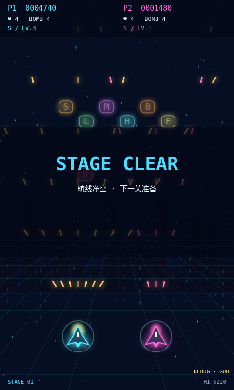

# 霓虹航线 NEON VECTOR

用浏览器直接打开 `index.html` 即可游玩（支持 `file://`），无需安装、构建、服务器或联网。推荐桌面版现代 Chrome、Edge、Firefox。所有图形由 Canvas 代码绘制，无外部资源。

## 操作

- 菜单：上下键或 W/S 选择，Enter / 空格确认；1 / 2 直接开始单人 / 双人。
- P1：WASD 移动，空格射击，Q 或左 Shift 炸弹。
- P2：方向键移动，Enter 射击，右 Shift 或 / 炸弹。
- P 或 Esc 暂停 / 继续；结束或通关后 Enter / R 返回菜单。
- 手柄：第一个已连接手柄控制 P1，第二个控制 P2。左摇杆 / 十字键移动，A 射击，B 炸弹，Start 暂停；菜单可按第一个手柄 Start 开始。手柄 API 是否可用取决于浏览器及 file:// 安全策略；键盘始终可玩。

## 玩法

三关依次为霓虹港、紫晶裂隙、日冕要塞。清除定时波次后挑战不同造型与弹幕的 Boss。Boss 在剩余血量 66% 和 32% 时变换阶段。击败后显示 STAGE CLEAR，随后进入下一关，第三关后结算总分。双人各自计分，一方耗尽生命后另一方仍可继续。小型明亮机心为玩家判定点。

初始每人 3 命、3 炸弹。炸弹清空敌弹并对全部敌人造成 95 伤害。被击中优先消耗护盾，否则损失一命、当前武器降一级并重生，获得 2.5 秒闪烁无敌。

敌机有概率掉落字母胶囊，Boss 必掉多个。靠近道具会吸附，撞到即可拾取：

| 字母 | 效果 |
| --- | --- |
| N（青） | 普通弹：1–3 条平行弹道 |
| S（橙） | 散射：3 / 5 / 7 条扇形弹道 |
| L（绿） | 激光：1–3 条高速加宽长光束 |
| M（紫） | 追踪导弹：2 / 3 / 4 枚，转向最近敌人 |
| H（浅青） | 12 秒护盾，可抵挡一次命中 |
| V（粉红） | 生命 +1 |
| B（橙黄） | 炸弹 +1 |
| F（金） | 分数奖章 +1000 |

武器类型按 N → S → L → M 提供四种不同战斗方式，道具可直接切换至对应类型。同类升级一级（最高 3），满级再拾取 +500 分；不同类型切换时恢复该类型已保存的等级，首次为 1 级。受击只降低当前类型保存的等级。最高分为单局所有玩家分数之和，尝试保存在 localStorage；浏览器禁止本地存储时仍可正常游玩。

P1 子弹沿用各弹型原色；P2 普通弹与机体同为品红色，散射、激光和导弹分别采用粉红、浅品红和紫色，以区分两名玩家。道具胶囊颜色保持不变。

## 调试与自动化

仅 `index.html?debug=1` 启用调试键和参数，并在角落显示 DEBUG：

- B：立即清除普通敌人并召唤当前关 Boss。
- N：跳下一关并显示关卡提示，第三关后进入通关画面。
- I：切换无敌；K：给当前 Boss 扣除 1200 血。
- U：在每位存活玩家前方生成全部八种道具。
- `&stage=2`：从第二关开始并跳过菜单（可设 1–3）。
- `&mode=2`：直接双人开局；`&mode=1` 直接单人。
- `&god=1`：无敌。例如 `index.html?debug=1&stage=2&mode=2&god=1`。

普通 URL 下 stage、mode、god 均不生效。调试键在非暂停的局内使用。

`window.__game` 暴露实时只读状态入口：`state`（menu / intro / playing / paused / clear / gameover / victory）、`stage`（1–3）、`players`（含 weapon、level、lives、bombs、score 等）、`enemies` 数量、`pickups` 数量、`boss` 是否存在，以及 `mode` 和 `god`。

`window.__game.snapshot()` 返回冻结的独立状态副本，包含 `state`、`stage`、`mode`、`bossActive`、`bossHp`、`enemies`、`pickups`，以及 `players: [{weapon, level, lives, bombs, score, shield}]`。`enemies` 和 `pickups` 为数量，无 Boss 时 `bossHp` 为 `0`；快照及其玩家数组、玩家对象均不可修改，后续游戏更新也不会改变已取得的快照。现有属性接口保持兼容。

离线模拟测试使用 Node 内置模块，不依赖浏览器、服务器或网络：

```sh
node tests/sim-test.cjs
```

## 文件

- `index.html`：入口，普通 script 按依赖顺序加载。
- `css/style.css`：480×800 等比缩放与居中。
- `js/input.js`、`player.js`、`weapons.js`：键盘 / 手柄、玩家、弹型。
- `js/enemies.js`、`boss.js`、`pickups.js`、`stages.js`：敌机、Boss、道具、时间轴。
- `js/render.js`、`main.js`：绘制 / HUD、状态机及 requestAnimationFrame 驱动的 60Hz 固定时间步长。

## 在线试玩

<https://waynenb.github.io/shmup-game/>

## 截图

| 双人：散射 Lv3 + 激光 Lv3 | 关卡通关与 Boss 掉落 | 第 3 关 Boss |
| --- | --- | --- |
|  |  |  |

浏览器自动化验证（需要 Playwright：`pip install playwright && python -m playwright install chromium`）：

```sh
python tests/browser-verify.py
python tests/browser-verify-drops.py
```
