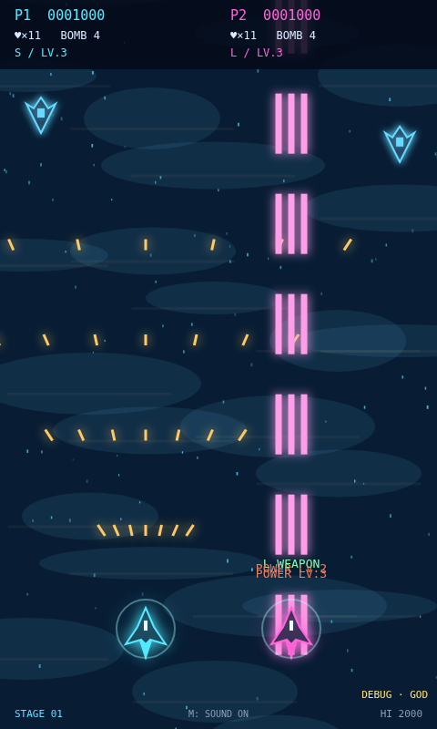

# 霓虹航线 NEON VECTOR

用浏览器直接打开 `index.html` 即可游玩（支持 `file://`），无需安装、构建、服务器或联网。推荐桌面版现代 Chrome、Edge、Firefox。所有图形由 Canvas 代码绘制，无外部资源。

## 操作

- 菜单：上下键或 W/S 选择，Enter / 空格确认；1 / 2 直接开始单人 / 双人。
- P1：WASD 移动，空格射击，Q 或左 Shift 炸弹。
- P2：方向键移动，Enter 射击，右 Shift 或 / 炸弹。
- M：切换声音开关，自动保存静音设置。
- P 或 Esc 暂停 / 继续；结束或通关后 Enter / R 返回菜单。
- 手柄：第一个已连接手柄控制 P1，第二个控制 P2。左摇杆 / 十字键移动，A 射击，B 炸弹，Start 暂停；菜单可按第一个手柄 Start 开始。手柄 API 是否可用取决于浏览器及 file:// 安全策略；键盘始终可玩。

## 玩法

八关从近地云层出发，穿越海上舰队、沙漠峡谷、冰原、火山、城市和碎星轨道，最终突入外星母舰。清除定时波次后挑战不同造型与弹幕的 Boss。Boss 在剩余血量 66% 和 32% 时变换阶段。击败后显示 STAGE CLEAR，随后进入下一关，第八关后进入 ALL 8 STAGES CLEAR 结局并结算总分，显示「核心沉寂，黎明重返地球。」双人各自计分，一方耗尽生命后另一方仍可继续。小型明亮机心为玩家判定点。

初始每人 10 命、3 炸弹，单人和双人模式中每名玩家的炸弹持有上限均为 5，满时拾取炸弹改为 +500 分。炸弹清空敌弹并对全部敌人造成 95 伤害。被击中优先消耗护盾，否则损失一命、当前武器降一级并重生，炸弹重置为 3（死前 0 或 5 都相同，双人各自独立），获得 2.2 秒闪烁无敌。

敌机有概率掉落字母胶囊，Boss 必掉多个。靠近道具会吸附，撞到即可拾取：

| 字母 | 效果 |
| --- | --- |
| N（青） | 普通弹：1–3 条平行弹道 |
| S（橙） | 散射：3 / 5 / 7 条扇形弹道 |
| L（绿） | 激光：1–3 条高速加宽长光束 |
| M（紫） | 追踪导弹：2 / 3 / 4 枚，转向最近敌人 |
| P（珊瑚红） | 火力等级 +1，最高 3；满级改为 +500 分 |
| H（浅青） | 12 秒护盾，可抵挡一次命中 |
| V（粉红） | 生命 +1，上限 15；满命改为 +500 分 |
| B（橙黄） | 炸弹 +1，上限 5；满时改为 +500 分 |
| F（金） | 分数奖章 +1000 |

武器类型按 N → S → L → M 提供四种不同战斗方式，道具可直接切换至对应类型。每名玩家只有一个共享等级（1–3）。类型道具只切换类型并保留等级；同类型重复拾取不升级，改为 +200 分。P 道具只升级、不切换类型。受击使共享等级降低一级，最低 1。最高分为单局所有玩家分数之和，尝试保存在 localStorage；浏览器禁止本地存储时仍可正常游玩。

P1 子弹沿用各弹型原色；P2 普通弹与机体同为品红色，散射、激光和导弹分别采用粉红、浅品红和紫色，以区分两名玩家。道具胶囊颜色保持不变。

## 难度

所有难度配置集中在 `js/difficulty.js` 的 `NV.DIFFICULTY`，在 input.js 之后加载；无依赖，仍支持 file://。`NV.difficulty(game, progress?, power?)` 纯读取当前派生参数，可传入测试进度和火力，不推进游戏状态。

令 `s(x)=x²(3−2x)`（x 限制在 0–1），关卡进度为 `stageTime / duration`，
`intensity = start + (end-start) × s(progress) + influence × power`。第一、二关 influence=0.10，第三至八关=0.20。
八关 start/end、时长标尺和 Boss 血量见下表。关卡衔接比较使用相同火力：后关零火力起点不低于前关零火力终点；同进度、同 power 下八关 intensity 严格递增。第八关满 power 时 intensity 为 1.30。后五关的实际战斗参数采用独立 `bullet.start/end` 压力区间（下表），动态火力加成及全部连续插值/软上限公式不变；`intensity` 保留连续关卡进度标尺。连续参数超过 1.2 后使用 `1.2 + 0.2 × (1−exp(−(intensity−1.2)/0.2))` 软上限；射击间隔单独以同切线指数曲线趋近 0.22s，避免负间隔。弹速对扣除 30% 火力影响后的强度使用同一软上限，最高低于 226px/s；第 4–8 关普通敌机在敌弹达到 124/128/132/136/140 时暂缓开火（当前 volley 仍完整发射，阈值不是硬截断上限），Boss 完整弹幕不截断。

存活玩家各自的目标火力为 `clamp(0.65 × clamp((level−1)/2)² + 0.04 × clamp(score/18000))`，等级 1/2/3 的等级贡献为 0/0.1625/0.65，减轻二级压力并保留满级密度。类型不参与火力评估，纯切换不会改变目标火力，双人取存活玩家平均。每帧以 `power += (target−power) × (1−exp(−dt/10))` 平滑，拾取与失去武器不会瞬间改变难度。

每个连续参数先按 `low + (high−low) × 战斗压力` 插值（前三关压力就是 intensity，后五关使用 bullet 区间），包括波次数量、刷波间隔、移速、血量、射击间隔、弹速、连发数与开火比例。随后按火力平滑增加 `count += 6 × power²`、`hp/heavyHp += 5 × power²`，并令 `fireInterval /= 1 + 1.2 × power²`。例如 power=0.6 时，每波额外约 2.16 架、血量额外 1.8、射击间隔除以 1.432；power=0 时这些加成为零，第一关开局参数保持原样。弹速只使用 70% 的火力强度加成（即按关卡强度 + 0.7 × influence × power 插值），使升级主要增加战场密度，并保持原有绝对步长平滑测试通过。第三至八关在火力数量加成后再将每波数量乘以 1.15，强化关卡档位而不提高前两关压力。数量用概率取整保持期望连续；刷波用累计 `dt/interval` 推进，不会因间隔缩短挤出历史波次。双人仅增加敌机数量 ×1.2、敌机及 Boss 血量 ×1.25。

第一关开局每波约 2 架、约 6 秒一波，只有约 25% 敌机会开火，重型每次也主要是单发。掉落率在第一关按同一 smoothstep 进度从 50% 平滑下降至 30%，后七关保持 30%，连续 3 次未掉落后保底；保底掉落为 P；第一关首次随机掉落必为 P 并扩大吸附范围，6 秒时额外提供一次近身 P 补给。随机掉落权重为 N/S/L/M 各 2、P 为 4、H 为 3、V 为 1、B/F 各 4（总计 24；类型合计 33.33%，P 为 16.67%，H 为 12.50%，V 为 4.17%）。Boss 掉落为 P/L/P/H/B/F。初始及复活无敌均为 2.2 秒，渲染保持闪烁；子弹碰撞额外半径 2.5，敌机碰撞额外半径 4。

Boss 基础血量为 260 / 850 / 1300 / 1550 / 1800 / 2050 / 2300 / 2600，最多受火力加成 10%。剩余血量低于 66% / 32% 解锁第二 / 第三阶段。技能按列表顺序轮换，每次先预警，再施放，最后休息；第一关完全不瞄准玩家。HUD 使用 `♥×10` 数字格式，并限制命数行宽为 211px，双人两栏不会重叠。

| 关卡 / 场景 | Boss | 技能（解锁阶段） | intensity（power=0） | 时长标尺 / 波数 | 基础 HP | 编队 |
|---|---|---|---|---|---|---|
| 01 近地云层 CLOUD FRONT（云层/薄光） | 天隼 SKY TALON | fan P1、ring P1、wall P2、spiral P3 | 0–0.28 | 65s / 12 | 260 | 原始横排，均衡三型 |
| 02 海上舰队 TIDAL FLEET（波纹/舰影） | 潮汐铁甲 TIDAL ARMOR | ring P1、spiral P1、laser P2、summon P2、homing P3 | 0.30–0.62 | 60s / 14 | 850 | V 字，轻型为主 |
| 03 沙漠峡谷 DUNE CANYON（岩壁/峡谷） | 砂岩巨蝎 DUNE SCORPION | sway P1、laser P1、charge P2、homing P2、wall P3、spiral P3 | 0.70–1.00 | 55s / 16 | 1300 | 侧翼收拢，快速型为主 |
| 04 极光冰原 FROZEN REACH（冰川/雪粒） | 冰晶冠冕 FROST CROWN | ring P1、wall P1、rain P2、laser P2、spiral P3 | 1.00–1.02 | 57s / 17 | 1550 | 错列，轻型为主 |
| 05 熔岩火山 MAGMA DESCENT（熔岩裂纹/火星） | 焚星熔炉 EMBER FORGE | fan P1、sway P1、cross P2、summon P2、rain P3 | 1.02–1.04 | 59s / 18 | 1800 | 深 V，重型为主 |
| 06 不夜之城 MIDNIGHT GRID（楼群/霓虹窗） | 霓虹执政官 NEON REGENT | sway P1、laser P1、homing P2、rain P2、charge P3 | 1.04–1.06 | 61s / 19 | 2050 | 正弦蛇形，快速型为主 |
| 07 碎星轨道 ORBITAL DEBRIS（小行星/星轨） | 星环守望 ORBIT WARDEN | spiral P1、ring P1、cross P2、homing P2、wall P3 | 1.06–1.08 | 63s / 20 | 2300 | 三列错峰，快速型为主 |
| 08 母舰核心 HIVE CORE（管道/格栅/舱板） | 零界之心 NULL HEART | rain P1、cross P1、summon P2、laser P2、charge P3、spiral P3 | 1.08–1.10 | 65s / 21 | 2600 | 交错纵队，重型为主 |

第 4–8 关 rain 改为两层（间隔 .5 秒），cross 每臂由 7 发改为 4 发；预警 1.15 秒、安全走廊 132px。其他技能解锁、双人锁定、武器及道具规则不变。各关独立 BGM 全部使用 Web Audio 合成。

Wayne 反馈后的后五关配置（第一至三关参数完全保留）：

| 关 | 战斗压力 start–end | 编队开火间隔倍率（N1 / S3） | 普通敌弹阈值 | Boss rest | ring / spiral | spacing | 技能弹速 |
|---|---|---:|---:|---:|---|---:|---:|
| 4 | .72–1.02 | 1 | 124 | 2.1 | 12 / 12 | 38 | 140 |
| 5 | .74–1.04 | 1.35→1.43 / 1.45 | 128 | 2.5 | 13 / 13 | 38 | 145 |
| 6 | .76–1.06 | 1.10 | 132 | 1.2 | 14 / 14 | 36 | 150 |
| 7 | .79–1.09 | 1.08 / 1.15 | 136 | .5 | 28 / 24 | 30 | 155 |
| 8 | .80–1.10 | 1.35→1.50 / 1.65 | 140 | 2.0 | 16 / 16 | 36 | 160 |

战斗压力替代曲线插值的输入，同时平滑调整每波数量、敌机速度/血量、射击间隔/弹速/发数/开火概率，避免仅拉长射击间隔造成参数关系失衡。低火力进度倍率用 smoothstep 插值，再按 clamp(power/.65) 连续过渡到满级倍率。编队间隔倍率同时用于首发和后续射击，补偿重型比例和移动路径；它不是独立难度排序，排序由最终密度复测。后五关在原波数之外持续补波至 duration−8 秒，防止满火力提前耗尽波次。Boss 血量、动态火力评估与 10 秒平滑、10 命、炸弹上限 5 均保留；`player.respawnBombs=3`。

密度工具：`node tests/density-profile.cjs` 输出 JSON；`--save` 保存 `tests/density-current.json`，`--quick` 用 3 种子调参，默认 12 固定种子。使用 Node VM、60Hz、god、固定站位 (240,690)，N1 固定 power=0，S3 固定 power=.65（满级等级贡献，分数为 0）；禁用射击、拾取和炸弹，测量敌弹压力，不混入击杀效率。只数 480×800 内且已结束 delay 的敌弹，三段按 duration 等分；Boss 单独清场后 spawnBoss，phase 1/2/3 各 10 秒，阶段间弹幕与技能状态连续。此口径与 novice-sim 的持续射击机器人不同，不能混比。

基线来自修改前的 HEAD 导出，保存于 `tests/density-baseline.json`。可离线复现：

```sh
mkdir -p /tmp/neon-head
git archive HEAD | tar -x -C /tmp/neon-head
NV_DENSITY_ROOT=/tmp/neon-head node tests/density-profile.cjs --head --baseline
node tests/density-profile.cjs --save
```


下表为 12 种子平均屏上敌弹数，单元格为 **HEAD → 当前**：


**N1**

| 关 | 前段 | 中段 | 后段 | Boss |
|---|---:|---:|---:|---:|
| 1 | 0.71 → 0.71 | 1.82 → 1.82 | 2.73 → 2.73 | 12.18 → 12.18 |
| 2 | 2.43 → 2.43 | 4.50 → 4.50 | 7.64 → 7.64 | 11.39 → 11.39 |
| 3 | 10.24 → 10.24 | 21.47 → 21.47 | 37.12 → 37.12 | 9.43 → 9.43 |
| 4 | 46.83 → 12.18 | 74.97 → 25.02 | 27.82 → 38.89 | 21.03 → 10.10 |
| 5 | 171.15 → 12.91 | 294.96 → 27.23 | 16.34 → 44.90 | 29.14 → 11.86 |
| 6 | 261.76 → 14.57 | 248.49 → 29.89 | 0.01 → 47.24 | 23.06 → 14.19 |
| 7 | 277.50 → 15.39 | 175.52 → 31.47 | 0.00 → 57.08 | 10.21 → 15.16 |
| 8 | 275.08 → 15.95 | 159.38 → 37.89 | 0.00 → 69.80 | 38.94 → 19.02 |

**S3**

| 关 | 前段 | 中段 | 后段 | Boss |
|---|---:|---:|---:|---:|
| 1 | 3.38 → 3.38 | 7.00 → 7.00 | 10.68 → 10.68 | 12.18 → 12.18 |
| 2 | 8.91 → 8.91 | 17.12 → 17.12 | 27.13 → 27.13 | 11.39 → 11.39 |
| 3 | 48.30 → 48.30 | 99.65 → 99.65 | 102.28 → 102.28 | 9.43 → 9.43 |
| 4 | 247.39 → 51.54 | 318.00 → 104.73 | 8.22 → 104.85 | 21.03 → 10.10 |
| 5 | 276.20 → 56.18 | 248.01 → 110.43 | 0.00 → 107.32 | 30.74 → 12.97 |
| 6 | 267.02 → 60.18 | 199.02 → 116.37 | 0.00 → 119.06 | 23.06 → 14.19 |
| 7 | 280.28 → 66.78 | 149.37 → 119.64 | 0.00 → 119.81 | 10.21 → 15.16 |
| 8 | 279.24 → 70.81 | 151.92 → 127.60 | 0.00 → 122.86 | 40.20 → 19.27 |

3→8 关两种 profile 四个测量段都单调递增，相邻比值在 1.0–1.3 内。第 8 关主段均值 N1 从 144.82 降至 41.21（−71.5%），S3 从 143.72 降至 107.09（−25.5%）。
第 7 关原 Boss 密度存在低谷（10.21），本次为保持后五关递增调整到 15.16；这是 Boss 降密度的例外，该关主段仍大幅降低。原 6–8 关后段接近零是波次耗尽导致，补波后后段恢复压力，因此不能只用这些空场段计算降幅。密度不是可躲性的完整指标，真人手感仍需试玩。

原有平滑、单调、跨关 intensity 衔接断言全部保留；新增压力通道/派生参数相邻比值 ≤1.3 和敌弹阈值递增断言。密度实测 JSON 带游戏源码 SHA-256，模拟测试拒绝过期数据，并断言 3→8 关所有段递增、相邻 ≤1.3、第 8 关主段降幅至少 25%、前三关与 HEAD 精确一致。唯一按新设计更新的旧断言是雨弹延迟层数：从 `[0,.5,1]` 改为 `[0,.5]`，并继续验证延迟层不会被屏外清理提前删除。新增死亡前炸弹 0/5、单人/双人独立重置测试。

激光固定在预警线 x 上，从 y=130 向下发射：持续 .7s、每 .05s 一发、弹速 650、半径 6，仍使用普通敌弹碰撞，可用炸弹清除。追踪弹每次 2 枚、速度 100、最大转向 .45rad/s、寿命 4s，可甩开；锁定玩家死亡后停止转向。召唤复用普通敌机，每次最多 2 架、场上最多 4 架召唤机。冲锋沿预警方向往返，历时 1.8s，最深到 y=560。激光、追踪和冲锋各自轮换锁定存活玩家，预警期间目标死亡则取消，全部阵亡不再施放。Boss 击败时清除全部敌弹、预警、持续技能及召唤机。

配置集中在 `NV.DIFFICULTY.bossSkills`、`skillTiers` 和 `skill`，附中文单位说明。`boss.skill` 为当前或最近技能名，`boss.skillsUsed` 按实际施放次数计数（仅预警不计）。

离线验收：`node tests/sim-test.cjs`；新手 200 种子：`node tests/novice-sim.cjs . 200`。新手模拟器的首次升级判定改为等级 > 1，类型切换不计升级；机器人、种子、时长及受击统计保持原样。`avgLivesLost` 统计实际掉命次数，不抵扣 V 道具。180s 包含后续关卡，不能视作仅第一关/Boss 的指标。

本轮重新平衡将随机 H 从 10/24 降到 3/24、P 从 1/24 提高到 4/24，减少依赖护盾和保底升级。等级权重从 0.7 改为 0.65，分数权重从 0.2 降为 0.04，限制共享等级和奖励分数的额外难度反馈。第一关强度终点从 0.22 提高至 0.28，以保留满级密度；平滑时间常数从 4s 延长至 10s，让升级后的压力更缓慢地建立。前两关 influence=0.1、第三关=0.2、连续三次未掉落后的 P 保底保持原样；护盾时长、无敌和初始命数不变。

取舍与对照（每项均为相同 200 种子）：同一掉落表、0.65/0.04 权重及第一关 0–0.28 区间，若沿用 4s 平滑，60s 单人闪避平均失命为 0.56，未达到 ≤0.50；改为 10s 后为 0.41，并保留 S3 同屏密度原阈值。单人仅随机从 1.08 变为 1.13、双人从 0.17 变为 0.23，仍分别低于 1.20/0.25。最终方案全部达到要求，不需要放宽验收；双人指标余量较小，结果只代表当前机器人及种子集。

此前基线验收（历史数据）：13 个 JS/CJS 文件全部通过 `node --check`，24 组模拟测试全部通过；新手每项 200 种子结果如下（双人掉命为队伍总计）：

| 模式 | 存活率 | 平均实际失命 | 升级率 | 首次升级中位数 |
| --- | ---: | ---: | ---: | ---: |
| 单人随机+闪避，60s | 100.0% | 0.41 | 100.0% | 8.4s |
| 单人仅随机，60s | 100.0% | 1.13 | 100.0% | 8.4s |
| 双人随机+闪避，60s | 100.0% | 0.23 | 100.0% | 8.4s |
| 单人随机+闪避，180s | 100.0% | 3.46 | 100.0% | 8.4s |

密度回归沿用模拟器固定 seed=3、15–60s 三个窗口的均值：

| 场景 | avgEnemies | avgEnemyBullets |
| --- | ---: | ---: |
| stage1_single_N1 | 6.72 | 5.45 |
| stage1_single_S3 | 4.36 | 4.38 |
| stage3_single_N1 | 13.24 | 35.47 |
| stage3 / stage1（N1） | 1.970 倍 | 6.513 倍 |

原始断言全部保留并通过：S3 敌机/敌弹均 ≥4，第三关/第一关 N1 敌机/敌弹均 >1.5 倍。单调、绝对步长平滑和指数平滑约束未放宽（时间常数由 4s 延长至 10s）；类型切换额外验证瞬时 intensity 及下一帧 power 轨迹精确一致。新增随机掉落表约束回归：总权重 24，H≤3、P≥3、V≤2、类型合计 8–12，B/F 均保留。

浏览器脚本增加普通 URL 开局 10 命断言、双人 HUD 文字宽度检查，以及仅脚本内部注入状态的 Boss 技能截图 `screenshots/boss_skills.png`（激光预警）与 `screenshots/boss_skills_wall.png`（缺口弹幕墙）；此前本地 Playwright Chromium 实测通过、控制台 0 错误；本轮未启动服务器，未重跑浏览器验收。可用 `python tests/browser-verify.py --skills-only` 仅验证本次新增项，无需服务器或游戏调试键。

## 调试与自动化

仅 `index.html?debug=1` 启用调试键和参数，并在角落显示 DEBUG：

- B：立即清除普通敌人并召唤当前关 Boss。
- N：跳下一关并显示关卡提示，第八关后进入通关画面。
- I：切换无敌；K：给当前 Boss 扣除 1200 血。
- U：在每位存活玩家前方生成全部九种道具。
- `&stage=2`：从第二关开始并跳过菜单（可设 1–8）。
- `&mode=2`：直接双人开局；`&mode=1` 直接单人。
- `&god=1`：无敌。例如 `index.html?debug=1&stage=2&mode=2&god=1`。

普通 URL 下 stage、mode、god 均不生效。调试键在非暂停的局内使用。

`window.__game` 暴露实时只读状态入口：`state`（menu / intro / playing / paused / clear / gameover / victory）、`stage`（1–8）、`players`（含 weapon、level、lives、bombs、score 等）、`enemies` 数量、`pickups` 数量、`boss` 是否存在，以及 `mode` 和 `god`。

`window.__game.snapshot()` 返回冻结的独立状态副本，包含 `state`、`stage`、`mode`、`bossActive`、`bossHp`、`bossSkill`（当前技能字符串，无 Boss 或尚未预警时为 null）、`enemies`、`pickups`，新增冻结的 `difficulty`（全部派生参数，含 intensity、power），以及 `players: [{weapon, level, lives, bombs, score, shield}]`。`enemies` 和 `pickups` 为数量，无 Boss 时 `bossHp` 为 `0`；快照及其玩家数组、玩家对象均不可修改，后续游戏更新也不会改变已取得的快照。现有属性接口保持兼容。

离线模拟测试使用 Node 内置模块，不依赖浏览器、服务器或网络：

```sh
node tests/sim-test.cjs
```

## 文件

- `index.html`：入口，普通 script 按依赖顺序加载。
- `css/style.css`：480×800 等比缩放与居中。
- `js/difficulty.js`：集中难度配置、连续曲线与火力缓动。
- `js/input.js`、`player.js`、`weapons.js`：键盘 / 手柄、玩家、弹型。
- `js/enemies.js`、`boss.js`、`pickups.js`、`stages.js`：敌机、Boss、道具、时间轴。
- `js/render.js`、`main.js`：绘制 / HUD、状态机及 requestAnimationFrame 驱动的 60Hz 固定时间步长。

## 在线试玩

<https://waynenb.github.io/shmup-game/>

## 截图

| 双人：散射 Lv3 + 激光 Lv3 | 关卡通关与 Boss 掉落 | 第 3 关 Boss |
| --- | --- | --- |
|  |  |  |

浏览器自动化验证（需要 Playwright：`pip install playwright && python -m playwright install chromium`）：

```sh
python tests/browser-verify.py
python tests/browser-verify-drops.py
```

## 合成音频

所有声音由 Web Audio API 在本地程序化合成，无音频文件、依赖或网络请求。首次键盘、指针或手柄操作后才创建 / 恢复 AudioContext；不支持音频、播放失败或禁止本地存储时仍可正常游玩。M 键没有与现有操作冲突，菜单及底部 HUD 显示 SOUND ON/OFF，静音设置保存到 localStorage。

菜单、关卡和 Boss 使用不同旋律与速度，关卡按 `NV.AUDIO.tracks` 数组取模选择调式，可继续添加关卡曲目。音乐采用 25ms lookahead 调度、柔和波形与低通滤波，切换时淡入淡出。四种武器各有低音量短音，每位玩家限流 80ms；炸弹使用滤波噪声与低频正弦下滑。声音统一经过主音量总线和压缩器。

`NV.audio` 是冻结的只读状态入口：`loaded`、`muted`、`ready`（已创建 context）与 `track`（menu / stage-曲目 / boss-曲目）。`js/audio.js` 在 input.js 后加载。离线模拟包含无 AudioContext、存储禁用、首次解锁、音效节流、炸弹触发及曲目切换；浏览器脚本在普通 URL 下检查 loaded、交互解锁及 M 往返切换。


八关扩展的离线验收使用 `node tests/sim-test.cjs`，覆盖八关正常介绍、波次结束、Boss 各阶段/全部技能、清关和最终 victory；所有关卡继续使用原有密集采样单调/平滑约束。`tests/browser-verify.py` 保留原检查，并通过脚本内 `NV.beginStage` 截取 `stage02_scene.png`、`stage04_scene.png`、`stage06_scene.png`、`stage08_scene.png`，最后断言 victory 与零控制台错误。浏览器截图需运行该脚本后生成。以上旧 200 种子数据为扩展前基线，不代表新场景实测结果。

此前八关扩展的 40 种子快速确认：60s 单人随机+闪避平均失命 0.40、仅随机 1.10、双人随机+闪避队伍平均失命 0.23，三项存活率及升级率均为 100%；180s 单人随机+闪避平均失命 3.25，存活率 100%。统计口径保持不变，200 种子及浏览器结果待外部复核。

Wayne 反馈本轮验收：14 个 JS/CJS 通过 `node --check`；28 组离线模拟测试通过；密度默认 12 种子实测通过上述单调、相邻比值及降幅检查。40 种子新手快速确认：60s 单人闪避/单人随机/双人闪避平均实际失命分别 0.40 / 1.10 / 0.23，180s 单人闪避 3.17；四项存活率和升级率均 100%，首次升级中位数均 8.4s。未联网、未启动服务器、未提交 git；200 种子由外部复核。
