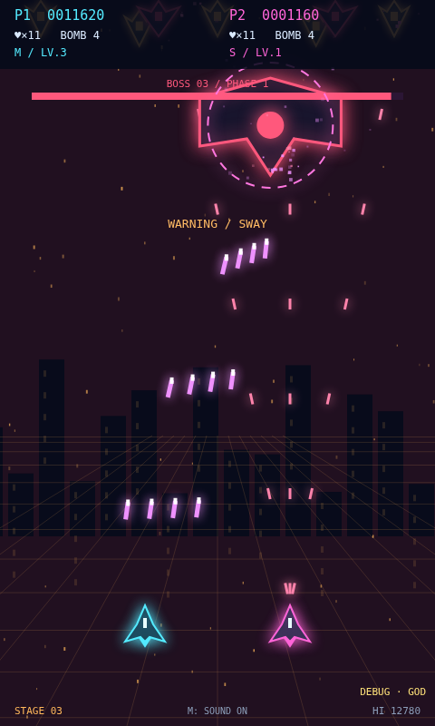

# 霓虹航线 NEON VECTOR

用浏览器直接打开 `index.html` 即可游玩（支持 `file://`），无需安装、构建、服务器或联网。推荐桌面版现代 Chrome、Edge、Firefox。所有图形由 Canvas 代码绘制，无外部资源。

## 操作

- 菜单：上下键或 W/S 选择，Enter / 空格确认；1 / 2 直接开始单人 / 双人。
- P1：WASD 移动，空格射击，Q 或左 Shift 炸弹。
- P2：方向键移动，Enter 射击，右 Shift 或 / 炸弹。
- M：切换声音开关，自动保存静音设置。
- P 或 Esc 暂停 / 继续；结束或通关后 Enter / R 返回菜单。
- 手柄：第一个已连接手柄控制 P1，第二个控制 P2。左摇杆 / 十字键移动，A 射击，B 炸弹，Start 暂停；菜单可按第一个手柄 Start 开始。手柄 API 是否可用取决于浏览器及 file:// 安全策略；键盘始终可玩。

## 玩法

三关依次为霓虹港、紫晶裂隙、日冕要塞。清除定时波次后挑战不同造型与弹幕的 Boss。Boss 在剩余血量 66% 和 32% 时变换阶段。击败后显示 STAGE CLEAR，随后进入下一关，第三关后结算总分。双人各自计分，一方耗尽生命后另一方仍可继续。小型明亮机心为玩家判定点。

初始每人 10 命、3 炸弹，单人和双人模式中每名玩家的炸弹持有上限均为 5，满时拾取炸弹改为 +500 分。炸弹清空敌弹并对全部敌人造成 95 伤害。被击中优先消耗护盾，否则损失一命、当前武器降一级并重生，获得 2.2 秒闪烁无敌。

敌机有概率掉落字母胶囊，Boss 必掉多个。靠近道具会吸附，撞到即可拾取：

| 字母 | 效果 |
| --- | --- |
| N（青） | 普通弹：1–3 条平行弹道 |
| S（橙） | 散射：3 / 5 / 7 条扇形弹道 |
| L（绿） | 激光：1–3 条高速加宽长光束 |
| M（紫） | 追踪导弹：2 / 3 / 4 枚，转向最近敌人 |
| H（浅青） | 12 秒护盾，可抵挡一次命中 |
| V（粉红） | 生命 +1，上限 15；满命改为 +500 分 |
| B（橙黄） | 炸弹 +1，上限 5；满时改为 +500 分 |
| F（金） | 分数奖章 +1000 |

武器类型按 N → S → L → M 提供四种不同战斗方式，道具可直接切换至对应类型。同类升级一级（最高 3），满级再拾取 +500 分；不同类型切换时恢复该类型已保存的等级，首次为 1 级。受击只降低当前类型保存的等级。最高分为单局所有玩家分数之和，尝试保存在 localStorage；浏览器禁止本地存储时仍可正常游玩。

P1 子弹沿用各弹型原色；P2 普通弹与机体同为品红色，散射、激光和导弹分别采用粉红、浅品红和紫色，以区分两名玩家。道具胶囊颜色保持不变。

## 难度

所有难度配置集中在 `js/difficulty.js` 的 `NV.DIFFICULTY`，在 input.js 之后加载；无依赖，仍支持 file://。`NV.difficulty(game, progress?, power?)` 纯读取当前派生参数，可传入测试进度和火力，不推进游戏状态。

令 `s(x)=x²(3−2x)`（x 限制在 0–1），关卡进度为 `stageTime / duration`，
`intensity = start + (end-start) × s(progress) + 0.20 × power`。
三关的 start/end 分别为 0/0.22、0.30/0.62、0.70/1.00，时长标尺分别为 65/60/55 秒。强度允许达到 1.20。关卡衔接比较使用相同火力：后关起点（power=0）不低于前关终点（power=0），同进度、同 power 下第 3 关 > 第 2 关 > 第 1 关；不再要求后关零火力起点高于前关满火力终点。

存活玩家各自的目标火力为 `clamp(0.6 × clamp((level−1)/2 + typeBonus) + 0.4 × clamp(score/18000))`，类型加成为 N=0、S=0.12、L=0.10、M=0.15，双人取存活玩家平均。每帧以 `power += (target−power) × (1−exp(−dt/4))` 平滑，拾取与失去武器不会瞬间改变难度。

每个连续参数先按 `low + (high−low) × intensity` 插值，包括波次数量、刷波间隔、移速、血量、射击间隔、弹速、连发数与开火比例。随后按火力平滑增加 `count += 6 × power²`、`hp/heavyHp += 5 × power²`，并令 `fireInterval /= 1 + 2 × power²`。例如 power=0.6 时，每波额外约 2.16 架、血量额外 1.8、射击间隔除以 1.72；power=0 时这些加成为零，第一关开局参数保持原样。弹速只使用 70% 的火力强度加成（即按关卡强度 + 0.14 × power 插值），使升级主要增加战场密度，并保持原有绝对步长平滑测试通过。数量用概率取整保持期望连续；刷波用累计 `dt/interval` 推进，不会因间隔缩短挤出历史波次。双人仅增加敌机数量 ×1.2、敌机及 Boss 血量 ×1.25。

第一关开局每波约 2 架、约 6 秒一波，只有约 25% 敌机会开火，重型每次也主要是单发。掉落率在第一关按同一 smoothstep 进度从 50% 平滑下降至 30%，后两关保持 30%，连续 3 次未掉落后保底；第一关首次随机掉落必为当前武器并扩大吸附范围，6 秒时额外提供一次近身武器补给。初始及复活无敌均为 2.2 秒，渲染保持闪烁；子弹碰撞额外半径 2.5，敌机碰撞额外半径 4。

Boss 基础血量为 260 / 850 / 1300，最多受火力加成 10%。剩余血量低于 66% / 32% 解锁第二 / 第三阶段。技能按列表顺序轮换，每次先预警，再施放，最后休息；第一关完全不瞄准玩家。HUD 使用 `♥×10` 数字格式，并限制命数行宽为 211px，双人两栏不会重叠。

| 关卡 | 技能（解锁阶段） | 主要参数 |
| --- | --- | --- |
| 1 | 扇形 P1、慢环形 P1、宽缺口墙 P2、慢螺旋 P3 | 预警 1.1s；休息 2s；弹速 70；扇形 3/4/5 发，间隔角 .18rad；环形 10 发；墙间距 28、缺口 156；螺旋 10 发、每 .22s 一发 |
| 2 | 旋转环形 P1、螺旋 P1、激光弹串 P2、召唤 P2、弱追踪 P3 | 预警 1s；休息 1.2s；弹速 120；环形 16 发；螺旋 16 发、每 .14s 一发 |
| 3 | 双侧摆动 P1、激光弹串 P1、冲锋 P2、追踪 P2、缺口墙 P3、螺旋 P3 | 预警 1s；休息 1s；弹速 150；双侧各 9/11/13 发；墙间距 24、缺口 120；螺旋 22 发、每 .11s 一发 |

激光固定在预警线 x 上，从 y=130 向下发射：持续 .7s、每 .05s 一发、弹速 650、半径 6，仍使用普通敌弹碰撞，可用炸弹清除。追踪弹每次 2 枚、速度 100、最大转向 .45rad/s、寿命 4s，可甩开；锁定玩家死亡后停止转向。召唤复用普通敌机，每次最多 2 架、场上最多 4 架召唤机。冲锋沿预警方向往返，历时 1.8s，最深到 y=560。激光、追踪和冲锋各自轮换锁定存活玩家，预警期间目标死亡则取消，全部阵亡不再施放。Boss 击败时清除全部敌弹、预警、持续技能及召唤机。

配置集中在 `NV.DIFFICULTY.bossSkills`、`skillTiers` 和 `skill`，附中文单位说明。`boss.skill` 为当前或最近技能名，`boss.skillsUsed` 按实际施放次数计数（仅预警不计）。

离线验收：`node tests/sim-test.cjs`；新手 200 种子：`node tests/novice-sim.cjs . 200`。新手模拟器无需修改，`avgLivesLost` 原本就统计实际掉命次数，不受初始命数增加影响。

本次离线验收：12 个 JS/CJS 文件全部通过 `node --check`，19 组模拟测试全部通过；新手每项 200 种子结果如下（双人掉命为队伍总计）：

| 模式 | 存活率 | 平均实际失命 | 升级率 |
| --- | ---: | ---: | ---: |
| 单人随机+闪避，60s | 100% | 0.47 | 100% |
| 单人仅随机，60s | 100% | 1.15 | 100% |
| 双人随机+闪避，60s | 100% | 0.23 | 100% |
| 单人随机+闪避，180s | 100% | 3.98 | 100% |

浏览器脚本增加普通 URL 开局 10 命断言、双人 HUD 文字宽度检查，以及仅脚本内部注入状态的 Boss 技能截图 `screenshots/boss_skills.png`（激光预警）与 `screenshots/boss_skills_wall.png`（缺口弹幕墙）；本地 Playwright Chromium 实测全部通过，控制台 0 错误。可用 `python tests/browser-verify.py --skills-only` 仅验证本次新增项，无需服务器或游戏调试键。

## 调试与自动化

仅 `index.html?debug=1` 启用调试键和参数，并在角落显示 DEBUG：

- B：立即清除普通敌人并召唤当前关 Boss。
- N：跳下一关并显示关卡提示，第三关后进入通关画面。
- I：切换无敌；K：给当前 Boss 扣除 1200 血。
- U：在每位存活玩家前方生成全部八种道具。
- `&stage=2`：从第二关开始并跳过菜单（可设 1–3）。
- `&mode=2`：直接双人开局；`&mode=1` 直接单人。
- `&god=1`：无敌。例如 `index.html?debug=1&stage=2&mode=2&god=1`。

普通 URL 下 stage、mode、god 均不生效。调试键在非暂停的局内使用。

`window.__game` 暴露实时只读状态入口：`state`（menu / intro / playing / paused / clear / gameover / victory）、`stage`（1–3）、`players`（含 weapon、level、lives、bombs、score 等）、`enemies` 数量、`pickups` 数量、`boss` 是否存在，以及 `mode` 和 `god`。

`window.__game.snapshot()` 返回冻结的独立状态副本，包含 `state`、`stage`、`mode`、`bossActive`、`bossHp`、`bossSkill`（当前技能字符串，无 Boss 或尚未预警时为 null）、`enemies`、`pickups`，新增冻结的 `difficulty`（全部派生参数，含 intensity、power），以及 `players: [{weapon, level, lives, bombs, score, shield}]`。`enemies` 和 `pickups` 为数量，无 Boss 时 `bossHp` 为 `0`；快照及其玩家数组、玩家对象均不可修改，后续游戏更新也不会改变已取得的快照。现有属性接口保持兼容。

离线模拟测试使用 Node 内置模块，不依赖浏览器、服务器或网络：

```sh
node tests/sim-test.cjs
```

## 文件

- `index.html`：入口，普通 script 按依赖顺序加载。
- `css/style.css`：480×800 等比缩放与居中。
- `js/difficulty.js`：集中难度配置、连续曲线与火力缓动。
- `js/input.js`、`player.js`、`weapons.js`：键盘 / 手柄、玩家、弹型。
- `js/enemies.js`、`boss.js`、`pickups.js`、`stages.js`：敌机、Boss、道具、时间轴。
- `js/render.js`、`main.js`：绘制 / HUD、状态机及 requestAnimationFrame 驱动的 60Hz 固定时间步长。

## 在线试玩

<https://waynenb.github.io/shmup-game/>

## 截图

| 双人：散射 Lv3 + 激光 Lv3 | 关卡通关与 Boss 掉落 | 第 3 关 Boss |
| --- | --- | --- |
|  |  |  |

浏览器自动化验证（需要 Playwright：`pip install playwright && python -m playwright install chromium`）：

```sh
python tests/browser-verify.py
python tests/browser-verify-drops.py
```

## 合成音频

所有声音由 Web Audio API 在本地程序化合成，无音频文件、依赖或网络请求。首次键盘、指针或手柄操作后才创建 / 恢复 AudioContext；不支持音频、播放失败或禁止本地存储时仍可正常游玩。M 键没有与现有操作冲突，菜单及底部 HUD 显示 SOUND ON/OFF，静音设置保存到 localStorage。

菜单、关卡和 Boss 使用不同旋律与速度，关卡按 `NV.AUDIO.tracks` 数组取模选择调式，可继续添加关卡曲目。音乐采用 25ms lookahead 调度、柔和波形与低通滤波，切换时淡入淡出。四种武器各有低音量短音，每位玩家限流 80ms；炸弹使用滤波噪声与低频正弦下滑。声音统一经过主音量总线和压缩器。

`NV.audio` 是冻结的只读状态入口：`loaded`、`muted`、`ready`（已创建 context）与 `track`（menu / stage-曲目 / boss-曲目）。`js/audio.js` 在 input.js 后加载。离线模拟包含无 AudioContext、存储禁用、首次解锁、音效节流、炸弹触发及曲目切换；浏览器脚本在普通 URL 下检查 loaded、交互解锁及 M 往返切换。
